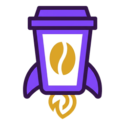

# ☕ Coffee Delivery — React + TypeScript + IA

> Aplicação SPA completa de cafeteria artesanal desenvolvida como **Projeto Final 05** da disciplina **Single Page Application (SPA)**, combinando React, TypeScript estrito, Context API + `useReducer`, consulta automática de endereço via ViaCEP, validação com React Hook Form + Zod, tema claro/escuro persistente, responsividade mobile-first, identidade visual original criada com IA e testes automatizados.

<p align="center">
  
</p>

---

## 🎯 Objetivos do Projeto

- Construir o fluxo completo de e-commerce de uma cafeteria em SPA (`Home → Checkout → Confirmação`) sem recarregamento de página.
- Consolidar conceitos essenciais de React e TypeScript: componentização, Props, Hooks, Context API, `useReducer`, imutabilidade, manipulação funcional de arrays (`map`, `filter`, `find`, `reduce`), rotas, formulários validados e persistência local.
- Integrar obrigatoriamente uma API pública de CEP (**ViaCEP**) para preenchimento automático de endereço com tratamento completo de carregamento, CEP não encontrado e indisponibilidade.
- Entregar identidade visual própria com **logo criada por IA**, **Light/Dark Mode**, **responsividade mobile-first** (`320px` a `1440px+`), **acessibilidade (WCAG 2.2 AA)**, especificações formais (`SPEC`) e suíte de testes automatizados.

---

## 🔗 Referências e Documentação SPEC

- **Protótipo de referência:** [Figma — Coffee Delivery • Projeto Final React](https://www.figma.com/design/yGPNTA0Yczb183EikXGIiA/Coffee-Delivery-%E2%80%A2-Projeto-Final-React?node-id=2-1297)
- **Product Requirements Document:** [`docs/PRD_SPEC.md`](./docs/PRD_SPEC.md)
- **Technical Specification:** [`docs/TECH_SPEC.md`](./docs/TECH_SPEC.md)
- **Plano de Tarefas e Validação:** [`docs/TASKS_SPEC.md`](./docs/TASKS_SPEC.md)
- **Uso de IA e Branding com IA:** [`docs/AI_USAGE.md`](./docs/AI_USAGE.md)
- **Diretrizes para Assistentes de IA:** [`AGENTS.md`](./AGENTS.md)

---

## 🛠️ Stack Tecnológica

| Tecnologia | Papel no Projeto |
| :--- | :--- |
| **React 19 + Vite + TypeScript (`strict`)** | Base SPA com tipagem estrita e proibição de `any` |
| **React Router (`react-router-dom`)** | Roteamento cliente (`/`, `/checkout`, `/success`) com layout compartilhado |
| **Context API + `useReducer`** | Estado global imutável do carrinho e snapshot independente do pedido |
| **styled-components** | Estilização componentizada com `ThemeProvider` tipado para Light e Dark Mode |
| **React Hook Form + Zod** | Formulário de checkout performático e validação declarativa |
| **ViaCEP API** | Consulta pública de CEP com máscara `00000-000`, `AbortController` e timeout |
| **`@phosphor-icons/react`** | Conjunto oficial de ícones da referência do Figma |
| **Vitest + Testing Library + jsdom** | Testes unitários e de integração dos fluxos principais |

---

## ✨ Funcionalidades Implementadas

### Fluxo Principal (`RF-01` a `RF-16`)
- **Catálogo completo (`RF-01`):** 14 cafés tipados com imagem, tags, nome, descrição e preço em BRL.
- **Busca e filtro por categoria (Diferencial Extra):** pesquisa por nome/descrição e filtros rápidos (`Todos`, `Tradicional`, `Gelado`, `Com leite`, `Especial`, `Alcoólico`).
- **Controle de quantidades e acúmulo (`RF-02`, `RF-03`, `RN-01`, `RN-02`):** seleção inteira positiva (`>= 1`) no card e acúmulo automático sem duplicar linhas no carrinho.
- **Badge dinâmico no Header (`RF-04`):** exibe a soma total de unidades (não apenas quantidade de tipos) e atualiza a cidade/UF após confirmação de pedido.
- **Gerenciamento no Checkout (`RF-05`, `RF-10`):** incrementar, decrementar (mínimo `1` no stepper + botão dedicado `Remover`), subtotal, taxa fixa (`R$ 3,50`) e total geral calculados em centavos (`RN-03`, `RN-04`).
- **Persistência local (`RF-06`, `RN-06`):** carrinho salvo em `@coffee-delivery:cart-v1` com re-hidratação segura contra JSON corrompido.
- **Checkout com ViaCEP e Zod (`RF-08`, `RF-09`, `RF-11`, `RN-05`, `RN-07`, `RN-10`):** preenchimento automático de rua, bairro, cidade e UF ao informar CEP válido; número manual e complemento opcional; tratamento de CEP inválido, não encontrado e erro de rede sem bloquear edição manual; seleção obrigatória de pagamento fictício (`Cartão de Crédito`, `Cartão de Débito` ou `Dinheiro`).
- **Confirmação preservada (`RF-12`, `RF-13`, `RN-06`, `RN-09`):** limpa o carrinho ao confirmar, mantendo snapshot imutável do pedido (`@coffee-delivery:last-order-v1`) acessível mesmo após recarregar `/success`, além de estados vazios amigáveis em `/checkout` e `/success`.
- **Light / Dark Mode (`RF-14`):** alternância completa via `ThemeToggle` no Header com persistência em `@coffee-delivery:theme-v1` e fallback automático para `prefers-color-scheme`.
- **Mobile-first e Acessibilidade (`RF-15`):** adaptação fluida de `320px` a `1440px+`, skip-link, `:focus-visible`, labels vinculados, `role="alert"`, `aria-live="polite"` e respeito a `prefers-reduced-motion`.

---

## 🎨 Branding com IA

A logo original (`src/assets/logo-mark.png` e `public/favicon.png`), a ilustração principal da Home (`src/assets/hero-coffee.png`), a ilustração de entrega (`src/assets/delivery-scooter.png`) e as bases fotográficas dos cafés foram criadas com auxílio de IA generativa, passando por curadoria visual e recorte para PNG transparente visando integração limpa nos modos claro e escuro.

- **Paleta Light (Figma):** `#FAFAFA` (fundo), `#F3F2F2` (cards), `#272221` (títulos), `#8047F8` (roxo), `#DBAC2C` (amarelo).
- **Paleta Dark (Espresso AA):** `#141113` (fundo), `#1F1B1E` (cards), `#F5F2F0` (títulos), `#8B5CF6` (roxo), `#E5B53B` (amarelo).
- **Tipografia:** `Baloo 2` (títulos e preços em destaque) e `Roboto` (textos, formulários e controles).

Os prompts exatos, escolhas curatoriais e todas as evidências do uso de IA durante a engenharia estão detalhados em [`docs/AI_USAGE.md`](./docs/AI_USAGE.md).

---

## 🚀 Como Executar Localmente

### Pré-requisitos
- Node.js `>= 20`
- npm `>= 10`

### Instalação e Scripts

```bash
# 1. Instalar dependências
npm install

# 2. Iniciar servidor de desenvolvimento
npm run dev

# 3. Executar suíte de testes automatizados
npm test

# 4. Executar verificação de lint (ESLint)
npm run lint

# 5. Gerar build de produção (checagem TypeScript + Vite)
npm run build

# 6. Visualizar o build de produção localmente
npm run preview
```

---

## 🧪 Evidências de Testes e Qualidade

Todos os fluxos principais e regras de negócio foram validados com **Vitest + Testing Library**:

- `src/tests/currency.test.ts` — 4 testes (cálculo inteiro em centavos, subtotal, taxa fixa e formatação BRL).
- `src/tests/cartReducer.test.ts` — 5 testes (imutabilidade, acúmulo sem duplicação, proteção contra `<= 0`, mínimo `1` no decremento, remoção e limpeza).
- `src/tests/checkoutSchema.test.ts` — 4 testes (endereço válido, normalização de UF, complemento opcional, rejeição de CEP/UF/pagamento inválidos).
- `src/tests/viacep.test.ts` — 5 testes (máscara, sucesso ViaCEP, CEP inválido, CEP não encontrado e falha de rede).
- `src/tests/appFlow.test.tsx` — 6 testes de integração ponta a ponta (catálogo + filtros, badge somando unidades, persistência em `localStorage`, edição/remoção no checkout, erro de CEP não encontrado, fluxo completo Home → Checkout → Sucesso com refresh, estados vazios e persistência de tema claro/escuro).

**Resultado verificado:** `24/24 testes aprovados` · `0 erros/avisos no ESLint` · `Build de produção sem erros`.

---

## ☁️ Deploy (Vercel / Netlify)

O repositório já inclui configuração de rewrite SPA para evitar erro `404` ao recarregar rotas internas (`/checkout`, `/success`):

- **Vercel:** [`vercel.json`](./vercel.json)
- **Netlify:** [`public/_redirects`](./public/_redirects)

Basta conectar o repositório GitHub na plataforma escolhida com comando de build `npm run build` e diretório de saída `dist`.

---

## 📁 Estrutura de Pastas

```text
coffee-delivery/
├── docs/                  # PRD_SPEC, TECH_SPEC, TASKS_SPEC e AI_USAGE
├── public/                # favicon.png e _redirects
├── src/
│   ├── assets/            # Logo IA, hero, entregador e 14 cafés em PNG transparente
│   ├── components/        # Componentes reutilizáveis estilizados e acessíveis
│   ├── contexts/          # CartProvider, ThemeProvider e definições de contexto
│   ├── data/              # Catálogo tipado dos 14 cafés
│   ├── hooks/             # useCart, useTheme, useLocalStorage e useCepLookup
│   ├── pages/             # Home, Checkout e Success
│   ├── reducers/cart/     # Ações e reducer imutável do carrinho
│   ├── schemas/           # Schema Zod do checkout
│   ├── services/          # Integração ViaCEP
│   ├── styles/            # Temas Light/Dark, styled.d.ts e GlobalStyle
│   ├── tests/             # Suítes Vitest + Testing Library
│   ├── types/             # Interfaces e tipos de domínio
│   └── utils/             # Cálculos em centavos e formatação BRL
├── AGENTS.md              # Diretrizes de trabalho com IA
├── vercel.json            # Rewrite SPA para Vercel
└── README.md
```
