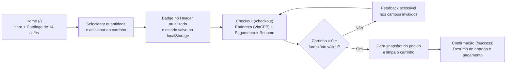

# PRD_SPEC — Coffee Delivery (Product Requirements Document)

> **Projeto:** Projeto Final 05 — Coffee Delivery (React + TypeScript + IA)  
> **Disciplina:** Single Page Application (SPA)  
> **Referência Visual:** [Figma — Coffee Delivery • Projeto Final React](https://www.figma.com/design/yGPNTA0Yczb183EikXGIiA/Coffee-Delivery-%E2%80%A2-Projeto-Final-React?node-id=2-1297)  
> **Versão:** 1.0  
> **Data:** Novembro de 2026

---

## 1. Visão Geral, Problema, Objetivos e Público-Alvo

### 1.1 Visão Geral
O **Coffee Delivery** é uma Single Page Application (SPA) de e-commerce para uma cafeteria artesanal com entrega rápida. O usuário navega pelo catálogo de cafés especiais, busca ou filtra bebidas por categoria, escolhe as quantidades desejadas, gerencia seu carrinho de compras persistente, preenche seu endereço com consulta automática via API pública de CEP, seleciona a forma de pagamento fictícia e recebe a confirmação detalhada do pedido.

### 1.2 Problema
Clientes que desejam pedir cafés artesanais pelo navegador ou celular frequentemente enfrentam fluxos confusos, perda dos itens do carrinho ao recarregar a página, preenchimento manual repetitivo de endereço e baixa legibilidade em ambientes com pouca luz ou telas pequenas.

### 1.3 Objetivos do Produto
- Entregar uma jornada completa de compra em SPA sem recarregamento de página (`Home → Checkout → Confirmação`).
- Reduzir atrito no checkout por meio de consulta automática a uma API pública de CEP (ViaCEP) e validação imediata de campos.
- Garantir persistência local confiável do carrinho, da preferência de tema e do resumo do último pedido confirmado.
- Oferecer identidade visual autoral coerente (com logo gerada por IA), alternância completa entre tema claro e escuro e responsividade mobile-first com acessibilidade orientada à WCAG 2.2 AA.

### 1.4 Público-Alvo
- Consumidores urbanos que pedem cafés artesanais em casa ou no escritório, tanto em desktop quanto em smartphones.
- Avaliadores e desenvolvedores que inspecionam arquitetura SPA, boas práticas de React/TypeScript, documentação técnica e uso responsável de IA.

---

## 2. Escopo, Funcionalidades e Exclusões

### 2.1 Dentro do Escopo
- Catálogo local tipado com os 14 cafés da referência do Figma (imagem, tags, nome, descrição, preço em BRL e seletor de quantidade).
- Busca por nome e filtro por categoria/tag no catálogo (melhoria de usabilidade sem alterar o fluxo principal).
- Carrinho global gerenciado com Context API + `useReducer` e persistido em `localStorage`.
- Header fixo/acessível com logo original criada com IA, badge de localização, alternância de tema claro/escuro e badge de carrinho somando todas as unidades.
- Checkout com consulta obrigatória à API pública ViaCEP, validação via React Hook Form + Zod, seleção de forma de pagamento fictícia, edição/remoção individual de itens e cálculo financeiro em centavos.
- Tela de confirmação (`/success`) exibindo um snapshot imutável do pedido confirmado mesmo após a limpeza automática do carrinho.
- Estados vazios claros para carrinho sem itens e acesso direto à rota `/success` sem pedido válido.
- Suporte completo a Light Mode e Dark Mode persistidos e responsividade de `320px` até `1440px+`.

### 2.2 Fora do Escopo (Exclusões)
- Backend próprio, banco de dados persistente em nuvem ou painel administrativo.
- Autenticação de usuários, cadastro de contas ou recuperação de senha.
- Gateway de pagamento real, emissão de nota fiscal ou processamento de cartão.
- Rastreamento em tempo real de entregadores por GPS.
- Chatbot embutido na interface (o uso de IA é documentado no processo de engenharia e identidade visual).

---

## 3. Fluxos de Usuário

### 3.1 Jornada Principal (`Home → Checkout → Confirmação`)

### 3.2 Fluxos Secundários e de Exceção
- **Carrinho vazio no Checkout:** exibe componente `EmptyCart` com explicação clara e botão de retorno ao catálogo (`/`).
- **Consulta de CEP com falha ou inexistente:** informa erro acessível no campo CEP (`CEP não encontrado` ou `Não foi possível consultar o CEP no momento`) e mantém os campos de endereço editáveis manualmente para não bloquear o usuário.
- **Acesso direto a `/success` sem pedido concluído:** apresenta estado vazio orientando o usuário a escolher seus cafés na Home.
- **Recarregamento da página (F5):** restaura automaticamente o carrinho salvo, a preferência de tema e o último pedido confirmado.

---

## 4. Requisitos Funcionais (RF-01 a RF-16)

| ID | Requisito Funcional | Critério de Aceite Verificável |
| :--- | :--- | :--- |
| **RF-01** | Exibir catálogo de cafés com imagem, nome, descrição, preço e categoria/tag | Todos os 14 cafés são renderizados na Home com imagem válida, tags, título, descrição e preço formatado em BRL (`R$`). |
| **RF-02** | Selecionar a quantidade de cada café antes de adicioná-lo | Cada card inicia com quantidade `1`, permite incrementar/decrementar inteiros positivos (`>= 1`) e impede valores `<= 0`. |
| **RF-03** | Adicionar café ao carrinho e acumular quantidade de produto repetido | Adicionar o mesmo café novamente soma a nova quantidade ao item já existente, sem criar linhas duplicadas no carrinho. |
| **RF-04** | Exibir contador de unidades no Header | O badge no ícone do carrinho exibe a soma total das unidades (`reduce`), não apenas a quantidade de tipos distintos. |
| **RF-05** | Aumentar, diminuir e remover individualmente itens do carrinho | Alterações em cada `CartItem` no Checkout recalculam imediatamente subtotal, total e contador do Header. |
| **RF-06** | Persistir carrinho com `localStorage` | Ao recarregar a aplicação, os itens e quantidades adicionados anteriormente permanecem intactos. |
| **RF-07** | Navegar entre Home, Checkout e Confirmação com React Router | Transições entre `/`, `/checkout` e `/success` ocorrem no lado cliente sem full page reload. |
| **RF-08** | Preencher e validar endereço de entrega com consulta obrigatória a API pública de CEP | Ao preencher CEP com 8 dígitos válidos, a consulta ViaCEP preenche automaticamente rua, bairro, cidade e UF; número e complemento permanecem manuais. Erros de CEP inválido, não encontrado ou falha de rede exibem mensagens acessíveis. |
| **RF-09** | Selecionar uma forma de pagamento: crédito, débito ou dinheiro | Apenas uma opção pode ficar ativa; tentar confirmar sem escolher uma opção exibe erro de validação. |
| **RF-10** | Exibir subtotal dos produtos, taxa de entrega e total geral | Os três valores aparecem no resumo do Checkout, calculados em centavos e formatados em BRL com duas casas decimais. |
| **RF-11** | Impedir finalização com carrinho vazio ou formulário inválido | Botão de confirmação bloqueia envio inválido ou carrinho vazio e destaca erros com `role="alert"` / `aria-invalid`. |
| **RF-12** | Confirmar pedido fictício e mostrar endereço e forma de pagamento | A rota `/success` apresenta rua, número, complemento (se houver), bairro, cidade, UF, previsão de entrega e método de pagamento escolhido. |
| **RF-13** | Limpar o carrinho após pedido confirmado, preservando os dados do pedido concluído | Após confirmar, o badge do Header zera, o `localStorage` do carrinho é limpo e a página `/success` continua exibindo os dados completos do pedido (inclusive após refresh). |
| **RF-14** | Alternar entre light mode e dark mode | O botão `ThemeToggle` no Header alterna todas as telas e componentes entre tema claro e escuro, persistindo a preferência em `localStorage`. |
| **RF-15** | Adaptar layout, componentes, formulário e carrinho para dispositivos móveis | Home, Checkout e Sucesso operam sem rolagem horizontal e com alvos de toque confortáveis em `320px`, `375px`, `768px`, `1280px` e `1440px`. |
| **RF-16** | Aplicar logo original desenvolvida com auxílio de IA | A logo autoral gerada por IA está integrada ao Header (com adaptação light/dark), ao favicon da página e documentada na seção Branding com IA. |

---

## 5. Regras de Negócio (RN-01 a RN-10)

- **RN-01 — Quantidades:** Nunca permitir quantidade `<= 0` ou fracionária ao adicionar cafés. No carrinho, o botão de decremento (`-`) é desabilitado quando a quantidade do item é igual a `1`, evitando exclusões acidentais; a remoção do item ocorre explicitamente pelo botão **Remover** dedicado (seguindo o protótipo do Figma).
- **RN-02 — Produto único:** Cada café no carrinho é identificado pelo seu `coffee.id`. Novas adições do mesmo café somam `quantity` ao registro existente de forma imutável.
- **RN-03 — Cálculo financeiro e frete:** `subtotal = Σ (priceInCents × quantity)` e `total = subtotal + DELIVERY_FEE_IN_CENTS`. A taxa de entrega é centralizada em uma única constante de domínio: **`DELIVERY_FEE_IN_CENTS = 350` (`R$ 3,50`)**, aplicada quando há pelo menos 1 item no carrinho.
- **RN-04 — Precisão monetária:** Todos os preços e somatórios são armazenados e calculados como inteiros em centavos (`priceInCents`), sendo convertidos para moeda brasileira (`pt-BR`, `BRL`, duas casas decimais) apenas na camada de apresentação por meio de `Intl.NumberFormat`.
- **RN-05 — Pagamento fictício:** As opções `Cartão de Crédito`, `Cartão de Débito` e `Dinheiro` têm caráter estritamente informativo/simulado; nenhuma cobrança real ou armazenamento de dados bancários ocorre.
- **RN-06 — Persistência e snapshot do pedido:** O carrinho é salvo automaticamente em `localStorage` (`@coffee-delivery:cart-v1`). Ao confirmar a compra, gera-se um objeto `Order` imutável (snapshot com `id`, `createdAt`, `items`, `address`, `paymentMethod`, `subtotalInCents`, `deliveryFeeInCents`, `totalInCents`) persistido separadamente (`@coffee-delivery:last-order-v1`), desacoplado da limpeza posterior do carrinho.
- **RN-07 — Endereço e ViaCEP:** `complement` é opcional; `cep` (8 dígitos), `street`, `number`, `neighborhood`, `city` e `state` (UF com 2 letras válidas) são obrigatórios. A consulta à API ViaCEP (`https://viacep.com.br/ws/{cep}/json/`) ocorre automaticamente ao completar 8 dígitos (ou via botão "Buscar CEP"), com indicador de carregamento, tratamento de CEP não encontrado (`erro: true`) e tratamento de indisponibilidade/timeout, sempre permitindo edição manual para correções ou CEPs genéricos sem logradouro.
- **RN-08 — Origem dos dados:** O catálogo de 14 cafés é carregado de um módulo TypeScript local fortemente tipado (`src/data/coffees.ts`). A única integração externa obrigatória é a consulta de CEP no checkout.
- **RN-09 — Estados vazios:** Exibir telas de estado vazio amigáveis e acionáveis quando o carrinho estiver vazio em `/checkout` ou quando `/success` for acessada sem nenhum pedido confirmado registrado.
- **RN-10 — Bloqueio de confirmação inválida:** A finalização só é concluída quando o carrinho possui ao menos 1 item e o formulário passa integralmente pela validação Zod (endereço completo + forma de pagamento selecionada).

---

## 6. Requisitos Não Funcionais

- **Acessibilidade (WCAG 2.2 AA):** Contraste mínimo adequado em texto normal (`>= 4.5:1`) e elementos de interface nos dois temas; navegação integral por teclado (`Tab`, `Shift+Tab`, `Enter`, `Space`), indicadores `:focus-visible` nítidos, labels vinculados (`htmlFor`/`id`), `aria-live="polite"` para feedbacks de carrinho e CEP, `role="alert"` para mensagens de erro e `role="radiogroup"` para seleção de pagamento.
- **Responsividade Mobile-First:** Layout validado para `320px`, `375px/390px`, `768px` e `1280px/1440px`, sem overflow horizontal e com área clicável mínima confortável (`>= 40px–44px`) em controles interativos no mobile.
- **Desempenho:** Carregamento rápido com Vite, imagens otimizadas em `src/assets/` e transições suaves que respeitam `@media (prefers-reduced-motion: reduce)`.
- **Persistência e Resiliência:** Leitura segura de `localStorage` com `try/catch` e validação estrutural para evitar falhas caso o navegador bloqueie storage ou contenha JSON inválido.
- **Compatibilidade:** Navegadores modernos (Chrome, Edge, Firefox, Safari) em desktop e dispositivos móveis.

---

## 7. Marca com IA e Temas Claro / Escuro

- **Identidade Visual:** Mantém o nome comercial **Coffee Delivery** aliado a um emblema original gerado com IA (copo artesanal minimalista fundido a chama/vapor de entrega expressa nas cores roxo `#8047F8` e dourado `#DBAC2C`), acompanhado de wordmark em `Baloo 2` adaptado dinamicamente para alto contraste em fundos claros e escuros.
- **Favicon:** Versão quadrada de alta legibilidade da logo gerada com IA aplicada em `public/favicon.png` e referenciada no `index.html`.
- **Modos Light e Dark:** Inicialização baseada em preferência salva (`@coffee-delivery:theme-v1`) com fallback automático para `prefers-color-scheme`. Todos os tokens semânticos (fundo, cartões, inputs, bordas, textos, badges, botões, foco e erros) adaptam-se harmoniosamente em ambos os temas.

---

## 8. Critérios de Aceite Gerais e Decisões de Produto

1. Aplicação compila (`npm run build`) e passa em todos os testes automatizados (`npm test`) sem erros ou warnings críticos de TypeScript.
2. Fluxo completo `Home → Adicionar cafés → Ajustar no Checkout → Consultar CEP via ViaCEP → Selecionar pagamento → Confirmar → Visualizar Sucesso → Recarregar página` funciona ponta a ponta.
3. **Decisão de UX adicional (Desafio Extra):** Foi incluída busca por texto e filtro por categoria/tag (`Todos`, `Tradicional`, `Gelado`, `Com leite`, `Especial`, `Alcoólico`) na seção "Nossos cafés" para facilitar a descoberta no catálogo sem comprometer a fidelidade visual ao Figma.
4. **Decisão sobre localização no Header:** O indicador de cidade/UF no Header inicia em `São Paulo, SP` e atualiza-se automaticamente com a cidade/UF do último pedido confirmado pelo cliente.
